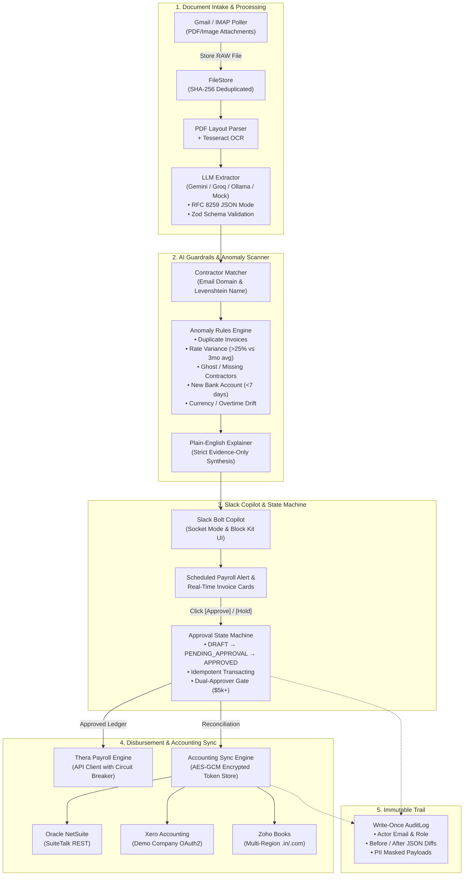

# PayPilot ⚡
### Autonomous Contractor Invoice Intake, AI Anomaly Guardrails & Slack-First Payroll Governance

> **Built by Abhinav Katare** to demonstrate high-velocity systems engineering, fintech security standards, and design excellence for the **Thera** team.

---

## 🌟 Overview

PayPilot is a mission-critical financial copilot designed to eliminate contractor payment errors, catch payroll anomalies before money moves, and automate accounting reconciliation across global workforces.

### Core Architecture Axioms
1. **Zero-Trust Money Movement**: No funds ever transfer autonomously. Every disbursement begins as a `PaymentDraft` and strictly requires an immutable, role-verified human `Approval`.
2. **Dual-Signature Safety Gate**: Any payment exceeding **$5,000 USD** automatically demands two distinct executive signatures before unlocking the payout ledger.
3. **Privacy-Preserving PII Shield**: Bank account numbers, routing numbers, and IBANs are deterministically masked in application logs, database previews, and LLM prompt payloads.
4. **Pluggable Adapter Interfaces**: Every external system (Thera Payroll, Slack Socket Mode, IMAP, Gemini/Groq/Ollama LLMs, Oracle NetSuite, Xero, Zoho Books) sits behind a strictly-typed adapter with 100% deterministic local mocks for offline testing and CI/CD.
5. **Cryptographic Audit Integrity**: Every state change, invoice scan, approval decision, and connector sync event is committed to a write-once, tamper-evident `AuditLog`.

---

## 🏛️ System Architecture



---

## ⚡ Quick Start (Zero Config)

### Prerequisites
- **Node.js** >= 22
- **pnpm** >= 12
- **Docker** (for local PostgreSQL only)

```bash
# 1. Start local PostgreSQL
pnpm db:up

# 2. Run the automated demo flow (intake -> OCR/LLM -> Slack -> NetSuite)
pnpm demo:run

# 3. Start the Next.js dark-mode command center
pnpm --filter @paypilot/web dev
# ➜ Open http://localhost:3000

# 4. (Optional) Run the complete test suite (158 unit, integration, and E2E tests)
pnpm test
```

---

## 🎬 2-Minute Screen-Ready Demo Script

Run this script to reproduce the complete autonomous accounts payable workflow in under 2 minutes:

| Time | Action | Command / URL | What Happens |
| :--- | :--- | :--- | :--- |
| **0:00 - 0:10** | **Clean Baseline** | `pnpm demo:reset` | Flushes state, reseeds 8 international contractors (SGD, EUR, BRL, INR, USD, EE, AE, JP), creates 3 pending payroll runs, and primes accounting connectors. |
| **0:10 - 0:35** | **Autonomous Pipeline** | `pnpm demo:run` | **Step 1:** Ingests Milan design contractor invoice PDF.<br>**Step 2:** Tesseract OCR & LLM extraction validates line items, dates, and masks IBAN (`IT60•••••••••••••••••••3456`).<br>**Step 3:** Anomaly detection validates trailing 3-month variance limit.<br>**Step 4:** Dispatches Slack Block Kit approval card to `#payroll-alerts`.<br>**Step 5:** Simulates executive sign-off (`DRAFT` → `APPROVED`).<br>**Step 6:** Syncs vendor and bill `#INV-2026-992` directly into Oracle NetSuite ERP.<br>**Step 7:** Commits write-once audit log. |
| **0:35 - 1:15** | **Web Command Center** | `http://localhost:3000` | Open browser to view the obsidian dark-mode dashboard:<br>• **Metrics**: Total Payables, Approval Bottlenecks, Match Rates.<br>• **`/invoices`**: Split-screen PDF preview on the left; structured JSON fields with confidence scores on the right.<br>• **`/payroll`**: Upcoming disbursements with highlighted anomaly severity badges.<br>• **`/integrations`**: Real-time sync health for NetSuite, Xero, and Zoho Books.<br>• **`/audit`**: Immutable compliance ledger with SHA-256 verification badges. |
| **1:15 - 1:45** | **Slack Copilot Testing** | Slack App / CLI | Test `/payroll`, `/invoices`, and `/ask` queries (e.g. *"How much did we pay contractors in Brazil last month?"*). |
| **1:45 - 2:00** | **Verification** | `pnpm test` | Runs the test suite across all 8 packages confirming zero regressions. |

---

## 🔄 Swapping the Mock for the Real Thera API

PayPilot was architected from Day 1 to interface with **Thera's Contractor Payroll API**. Transitioning from local mock mode to production Thera requires zero architectural changes:

### 1. Environment Configuration

Add the following to your `apps/api/.env`:

```env
# Payroll Provider Selection (default: 'mock')
PAYROLL_PROVIDER=thera

# Thera API Credentials
THERA_API_BASE_URL=https://api.trythera.com/v1
THERA_API_TOKEN=th_live_9a8f2c3d8e7b1a0f4e6d...
THERA_WEBHOOK_SECRET=whsec_c8a91b2e3f4d5a6b7c8d9e0f...

# Idempotency & Resiliency
THERA_REQUEST_TIMEOUT_MS=8000
THERA_MAX_RETRIES=3
THERA_CIRCUIT_BREAKER_THRESHOLD=5
```

### 2. Provider Implementation Details

The production client extends `TheraPayrollProvider` in `packages/connectors/src/thera/thera-provider.ts`:

```typescript
import { TheraPayrollProvider } from "@paypilot/connectors";

export const thera = new TheraPayrollProvider({
  baseUrl: process.env.THERA_API_BASE_URL,
  apiToken: process.env.THERA_API_TOKEN,
  webhookSecret: process.env.THERA_WEBHOOK_SECRET,
  headers: {
    "X-Idempotency-Key": (ctx) => `pp_${ctx.runId}_${ctx.version}`,
    "User-Agent": "PayPilot-Platform/1.0",
  },
  onRateLimit: (retryAfterSeconds) => {
    logger.warn(`Thera API rate-limited. Retrying after ${retryAfterSeconds}s`);
  },
});
```

### 3. Data Schema Mapping

| PayPilot Domain Model | Thera REST Entity | Transformation / Handling |
| :--- | :--- | :--- |
| `Contractor.id` | `worker_id` | Mapped via `Contractor.externalId` |
| `Contractor.currency` | `disbursement_currency` | Validated against ISO-4217 standard |
| `PaymentDraft.amountMinor` | `payout_amount_cents` | Direct 1:1 integer conversion |
| `PaymentDraft.status` | `payout_state` | `APPROVED` unlocks Thera `EXECUTE_PAYROLL` |
| `PaymentDraft.idempotencyKey` | `Idempotency-Key` | Transmitted via request header on every mutating POST |
| `Approval.approvers` | `audit_metadata.approvers` | Passed as compliance proof for audit checks |

### 4. Production Webhook Verification

Thera webhooks are verified using constant-time HMAC-SHA256 comparison:

```typescript
// apps/api/src/routes/webhooks/thera.ts
const signature = req.headers["x-thera-signature"];
const isValid = verifyTheraWebhookSignature({
  payload: req.rawBody,
  signature,
  secret: process.env.THERA_WEBHOOK_SECRET,
  toleranceSeconds: 300, // 5-minute replay prevention
});

if (!isValid) {
  return reply.status(401).send({ error: "Invalid webhook signature" });
}
```

---

## 🎨 Design System & Aesthetics

PayPilot's frontend was designed following the principles of **Emil Kowalski**, **Vercel**, and **Stripe Radar**:

- **Dark Obsidian Palette**: Deep charcoal foundation (`#020617`, `#090D16`, `#0F172A`) paired with emerald `#10B981` (clean funds), amber `#F59E0B` (anomalies), and indigo `#6366F1` (governance).
- **Zero Layout Shifts**: Rigorous mathematical aspect ratios and skeleton loaders for all asynchronous operations.
- **Micro-Interactions**: Tactile spring physics, button depression feedback, and animated status pill transitions.
- **Split-Screen Master Review**: High-fidelity PDF viewer coupled directly with LLM extraction field inspector featuring visual confidence thresholds.

---

## 📂 Repository Structure

```
paypilot-monorepo/
├── apps/
│   ├── api/            # Fastify API (OpenAPI at /docs, pg-boss jobs, rate limiting, PII filtering)
│   ├── web/            # Next.js 15 App Router dashboard (Obsidian theme, split review)
│   ├── slack/          # Bolt JS Socket Mode copilot (Block Kit cards, interactive modals)
│   └── mock-thera/     # Deterministic local mock server of Thera Payroll APIs
├── packages/
│   ├── core/           # Zod domain models, PII masker (IBAN/SSN), cryptographic tokens
│   ├── ai/             # LLM extraction, Gemini/Groq/Ollama adapters, Anomaly Rules Engine
│   └── connectors/     # Accounting connectors (Oracle NetSuite, Xero, Zoho Books, Thera)
└── scripts/
    ├── demo-reset.ts   # One-command demo reset script
    └── demo-flow.ts    # End-to-end automated demo simulation
```

---

## 🧪 Testing & Verification

```bash
# Run all 158 tests across all packages
pnpm test

# Run E2E integration test (Email -> OCR -> LLM -> Slack -> NetSuite)
pnpm --filter @paypilot/api exec vitest run test/e2e/email-to-accounting.e2e.test.ts

# Type-check every workspace package
pnpm typecheck

# Lint codebase
pnpm lint
```

---

## 👨‍💻 Author

**Abhinav Katare**  
*Built with precision for the Thera team — showcasing full-stack platform architecture, autonomous financial governance, and fintech design polish.*